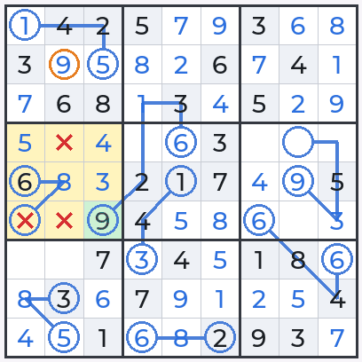

<!-- Written by tools/walkthrough.py double-arrow: edit the script, not this page. -->
# Double Arrow, step 42: the 9 in box 4

**Step 42 of 52** · [← Step 41](step-41.md) · [All steps](../double-arrow.md#the-whole-puzzle-step-by-step) · [Step 43 →](step-43.md)

Box 4 needs a 9. r4c2 and r6c2: column 2 has one (r2c2). r6c1: it's a circle: the cells between add up to 8 and the other circle is 6, so it's 2. Only **r6c3** is left: **r6c3 = 9**.

**Step 42 of 52** · [← Step 41](step-41.md) · [All steps](../double-arrow.md#the-whole-puzzle-step-by-step) · [Step 43 →](step-43.md)
