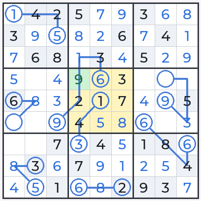

<!-- Written by tools/walkthrough.py double-arrow: edit the script, not this page. -->
# Double Arrow, step 43: the 9 in box 5

**Step 43 of 52** · [← Step 42](step-42.md) · [All steps](../double-arrow.md#the-whole-puzzle-step-by-step) · [Step 44 →](step-44.md)

Box 5 needs a 9, and r4c4 is its last empty cell: **r4c4 = 9**.

**Step 43 of 52** · [← Step 42](step-42.md) · [All steps](../double-arrow.md#the-whole-puzzle-step-by-step) · [Step 44 →](step-44.md)
