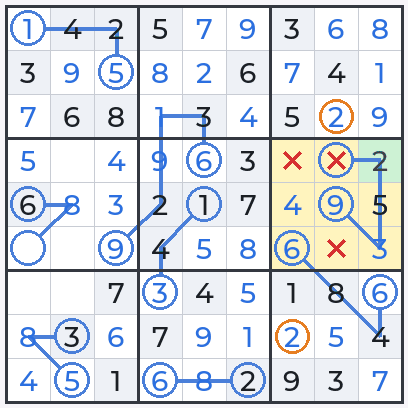

<!-- Written by tools/walkthrough.py double-arrow: edit the script, not this page. -->
# Double Arrow, step 44: the 2 in box 6

**Step 44 of 52** · [← Step 43](step-43.md) · [All steps](../double-arrow.md#the-whole-puzzle-step-by-step) · [Step 45 →](step-45.md)

Box 6 needs a 2. r4c7: column 7 has one (r8c7). r4c8 and r6c8: column 8 has one (r3c8). Only **r4c9** is left: **r4c9 = 2**.

**Step 44 of 52** · [← Step 43](step-43.md) · [All steps](../double-arrow.md#the-whole-puzzle-step-by-step) · [Step 45 →](step-45.md)
