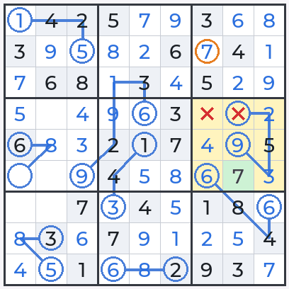

<!-- Written by tools/walkthrough.py double-arrow: edit the script, not this page. -->
# Double Arrow, step 45: the 7 in box 6

**Step 45 of 52** · [← Step 44](step-44.md) · [All steps](../double-arrow.md#the-whole-puzzle-step-by-step) · [Step 46 →](step-46.md)

Box 6 needs a 7. r4c7: column 7 has one (r2c7). r4c8: it's a circle: the cells between add up to 10 and the other circle is 9, so it's 1. Only **r6c8** is left: **r6c8 = 7**.

**Step 45 of 52** · [← Step 44](step-44.md) · [All steps](../double-arrow.md#the-whole-puzzle-step-by-step) · [Step 46 →](step-46.md)
