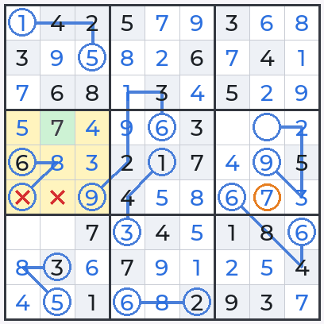

<!-- Written by tools/walkthrough.py double-arrow: edit the script, not this page. -->
# Double Arrow, step 46: the 7 in box 4

**Step 46 of 52** · [← Step 45](step-45.md) · [All steps](../double-arrow.md#the-whole-puzzle-step-by-step) · [Step 47 →](step-47.md)

Box 4 needs a 7. r6c1 and r6c2: row 6 has one (r6c8). Only **r4c2** is left: **r4c2 = 7**.

**Step 46 of 52** · [← Step 45](step-45.md) · [All steps](../double-arrow.md#the-whole-puzzle-step-by-step) · [Step 47 →](step-47.md)
