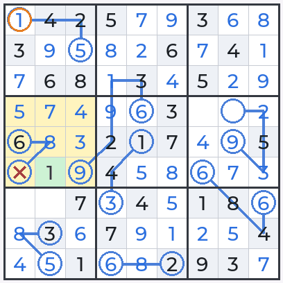

<!-- Written by tools/walkthrough.py double-arrow: edit the script, not this page. -->
# Double Arrow, step 47: the 1 in box 4

**Step 47 of 52** · [← Step 46](step-46.md) · [All steps](../double-arrow.md#the-whole-puzzle-step-by-step) · [Step 48 →](step-48.md)

Box 4 needs a 1. r6c1: column 1 has one (r1c1). Only **r6c2** is left: **r6c2 = 1**.

**Step 47 of 52** · [← Step 46](step-46.md) · [All steps](../double-arrow.md#the-whole-puzzle-step-by-step) · [Step 48 →](step-48.md)
