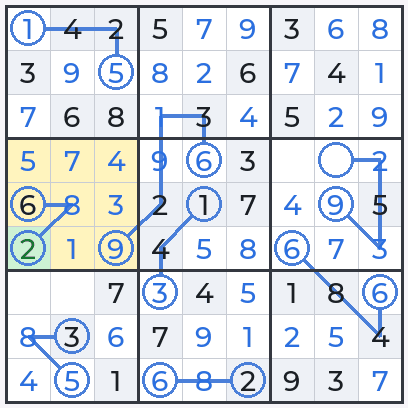

<!-- Written by tools/walkthrough.py double-arrow: edit the script, not this page. -->
# Double Arrow, step 48: the 2 in box 4

**Step 48 of 52** · [← Step 47](step-47.md) · [All steps](../double-arrow.md#the-whole-puzzle-step-by-step) · [Step 49 →](step-49.md)

Box 4 needs a 2, and r6c1 is its last empty cell: **r6c1 = 2**.

**Step 48 of 52** · [← Step 47](step-47.md) · [All steps](../double-arrow.md#the-whole-puzzle-step-by-step) · [Step 49 →](step-49.md)
