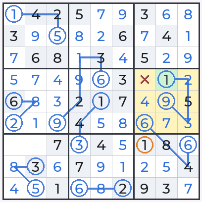

<!-- Written by tools/walkthrough.py double-arrow: edit the script, not this page. -->
# Double Arrow, step 49: the 1 in box 6

**Step 49 of 52** · [← Step 48](step-48.md) · [All steps](../double-arrow.md#the-whole-puzzle-step-by-step) · [Step 50 →](step-50.md)

Box 6 needs a 1. r4c7: column 7 has one (r7c7). Only **r4c8** is left: **r4c8 = 1**.

**Step 49 of 52** · [← Step 48](step-48.md) · [All steps](../double-arrow.md#the-whole-puzzle-step-by-step) · [Step 50 →](step-50.md)
