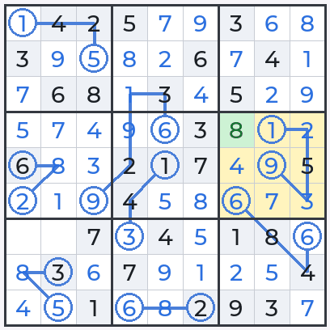

<!-- Written by tools/walkthrough.py double-arrow: edit the script, not this page. -->
# Double Arrow, step 50: the 8 in box 6

**Step 50 of 52** · [← Step 49](step-49.md) · [All steps](../double-arrow.md#the-whole-puzzle-step-by-step) · [Step 51 →](step-51.md)

Box 6 needs an 8, and r4c7 is its last empty cell: **r4c7 = 8**.

**Step 50 of 52** · [← Step 49](step-49.md) · [All steps](../double-arrow.md#the-whole-puzzle-step-by-step) · [Step 51 →](step-51.md)
