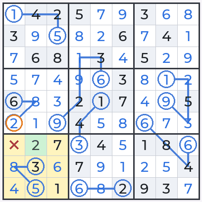

<!-- Written by tools/walkthrough.py double-arrow: edit the script, not this page. -->
# Double Arrow, step 51: the 2 in box 7

**Step 51 of 52** · [← Step 50](step-50.md) · [All steps](../double-arrow.md#the-whole-puzzle-step-by-step) · [Step 52 →](step-52.md)

Box 7 needs a 2. r7c1: column 1 has one (r6c1). Only **r7c2** is left: **r7c2 = 2**.

**Step 51 of 52** · [← Step 50](step-50.md) · [All steps](../double-arrow.md#the-whole-puzzle-step-by-step) · [Step 52 →](step-52.md)
