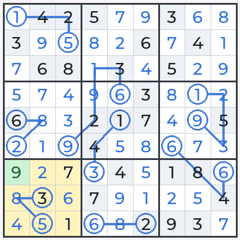

<!-- Written by tools/walkthrough.py double-arrow: edit the script, not this page. -->
# Double Arrow, step 52: the 9 in box 7

**Step 52 of 52** · [← Step 51](step-51.md) · [All steps](../double-arrow.md#the-whole-puzzle-step-by-step) · [All steps](../double-arrow.md#the-whole-puzzle-step-by-step)

Box 7 needs a 9, and r7c1 is its last empty cell: **r7c1 = 9**.

Solved.

**Step 52 of 52** · [← Step 51](step-51.md) · [All steps](../double-arrow.md#the-whole-puzzle-step-by-step) · [All steps](../double-arrow.md#the-whole-puzzle-step-by-step)
