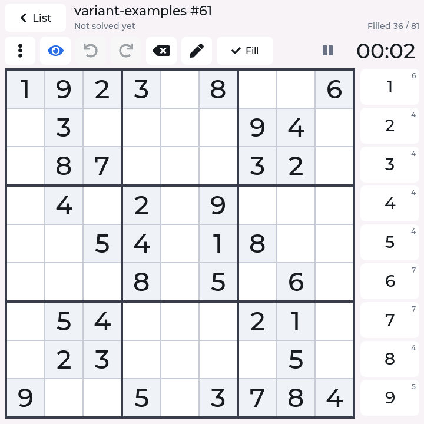
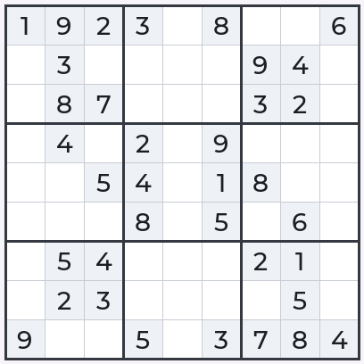

# Dutch Flatmates

[← All variants](README.md) · [Puzzles](../features-puzzles.md) · [How to play](../how-to-play.md)

## The rules

[Classic](classic.md) rules, and **every 5 has a 1 directly above it or a 9 directly below it** (or both). Nothing is drawn on the board: the rule holds everywhere. Only the 5s need flatmates: a 1 or a 9 can stand anywhere. So a 5 in the top row needs a 9 under it, and a 5 in the bottom row a 1 over it.

## On the board

- The board looks like Classic's; the **?** button in the top bar has the rule.
- A 5 that can no longer have either flatmate (the cell above holds another digit or there is none, and the same below) turns red, with those neighbours.
- The grader and hints know two steps: a 5 can't go where neither a 1 above nor a 9 below can come; and a 5 whose 1 can't come above takes a 9 below it (and the other way round). "Every 5 needs a 1 right above it or a 9 right below it. Row 4, column 7 can have neither, so it can't be a 5."
- **Puzzles → ⋮ → New puzzle → Marks → Flatmates**.

## How to solve it

- **A column's 5 sits by its 1 or its 9.** The flatmates are in the same column, so each column's 5 is right under that column's 1 or right over its 9: at most two places. Once a column's 1 and 9 are placed, look at just those two cells.
- **Check a 5's neighbours.** If the cell above a 5 can't be 1 (it holds another digit, or its row or box has a 1), the cell below must be 9; and the other way round.
- **Rule 5 out early.** A cell whose neighbour above can't be 1 and whose neighbour below can't be 9 isn't a 5, even when the Classic rules would allow one there.

## Worked example

**variant-examples #61**, Dutch Flatmates Easy (see [Classic](classic.md#worked-example-the-whole-puzzle) for how to import the examples; cells are written r*row*c*column*).

**Step 1: r4c7.** Row 4 has 4, 2 and 9; column 7 has 9, 3, 8, 2 and 7; box 6 has 8 and 6. By the Classic rules r4c7 could be 1 or 5. But a 5 there would need a 1 above it or a 9 below it, and r3c7 above is 3, r5c7 below is 8. **r4c7 = 1**.

**Step 2: r6c2, above a 5.** By the Classic rules r6c2 could be 1 or 7 (row 6 has 8, 5 and 6; column 2 has 9, 3, 8, 4, 5 and 2). It sits right above the 5 in r7c2, and the cell below that 5, r8c2, is 2, not 9: so the 5 needs its 1 above it. **r6c2 = 1**.

**Step 3: the 5 in column 1.** Column 1's 1 is in r1c1 and its 9 in r9c1, so its 5 is right under the 1 (r2c1) or right over the 9 (r8c1). Row 8 has a 5 already (r8c8). **r2c1 = 5**.

## The whole puzzle, step by step

<!-- walkthrough -->
<!-- Written by tools/walkthrough.py dutch-flatmates: edit the script, not this part. -->

The whole puzzle, from the start to the last cell: 45 steps, each one a single (one place left for a digit, or one digit left for a cell), taken in the order a box's single comes first, so not quite the order of the worked example above. Each step has a page of its own, with **Previous** and **Next**: pick its number below. In each picture, the unit the step looks at is tinted yellow (for a cell with one digit left: its row, column and box), the new digit is on green, the digits that rule cells out have an **orange ring**, and the empty cells they rule out a **red cross**. Givens are on grey, digits from earlier steps in blue.

| [1](dutch-flatmates/step-01.md) | [2](dutch-flatmates/step-02.md) | [3](dutch-flatmates/step-03.md) | [4](dutch-flatmates/step-04.md) | [5](dutch-flatmates/step-05.md) | [6](dutch-flatmates/step-06.md) | [7](dutch-flatmates/step-07.md) | [8](dutch-flatmates/step-08.md) | [9](dutch-flatmates/step-09.md) | [10](dutch-flatmates/step-10.md) |
|:-:|:-:|:-:|:-:|:-:|:-:|:-:|:-:|:-:|:-:|
| [11](dutch-flatmates/step-11.md) | [12](dutch-flatmates/step-12.md) | [13](dutch-flatmates/step-13.md) | [14](dutch-flatmates/step-14.md) | [15](dutch-flatmates/step-15.md) | [16](dutch-flatmates/step-16.md) | [17](dutch-flatmates/step-17.md) | [18](dutch-flatmates/step-18.md) | [19](dutch-flatmates/step-19.md) | [20](dutch-flatmates/step-20.md) |
| [21](dutch-flatmates/step-21.md) | [22](dutch-flatmates/step-22.md) | [23](dutch-flatmates/step-23.md) | [24](dutch-flatmates/step-24.md) | [25](dutch-flatmates/step-25.md) | [26](dutch-flatmates/step-26.md) | [27](dutch-flatmates/step-27.md) | [28](dutch-flatmates/step-28.md) | [29](dutch-flatmates/step-29.md) | [30](dutch-flatmates/step-30.md) |
| [31](dutch-flatmates/step-31.md) | [32](dutch-flatmates/step-32.md) | [33](dutch-flatmates/step-33.md) | [34](dutch-flatmates/step-34.md) | [35](dutch-flatmates/step-35.md) | [36](dutch-flatmates/step-36.md) | [37](dutch-flatmates/step-37.md) | [38](dutch-flatmates/step-38.md) | [39](dutch-flatmates/step-39.md) | [40](dutch-flatmates/step-40.md) |
| [41](dutch-flatmates/step-41.md) | [42](dutch-flatmates/step-42.md) | [43](dutch-flatmates/step-43.md) | [44](dutch-flatmates/step-44.md) | [45](dutch-flatmates/step-45.md) |  |  |  |  |  |

Solved.

<!-- /walkthrough -->
