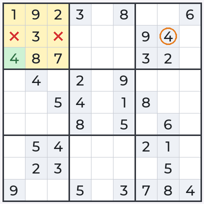

<!-- Written by tools/walkthrough.py dutch-flatmates: edit the script, not this page. -->
# Dutch Flatmates, step 1: the 4 in box 1

**Step 1 of 45** · [← The start](../dutch-flatmates.md#the-whole-puzzle-step-by-step) · [All steps](../dutch-flatmates.md#the-whole-puzzle-step-by-step) · [Step 2 →](step-02.md)

Box 1 needs a 4. r2c1 and r2c3: row 2 has one (r2c8). Only **r3c1** is left: **r3c1 = 4**.

**Step 1 of 45** · [← The start](../dutch-flatmates.md#the-whole-puzzle-step-by-step) · [All steps](../dutch-flatmates.md#the-whole-puzzle-step-by-step) · [Step 2 →](step-02.md)
