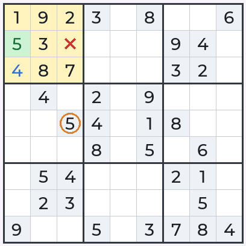

<!-- Written by tools/walkthrough.py dutch-flatmates: edit the script, not this page. -->
# Dutch Flatmates, step 2: the 5 in box 1

**Step 2 of 45** · [← Step 1](step-01.md) · [All steps](../dutch-flatmates.md#the-whole-puzzle-step-by-step) · [Step 3 →](step-03.md)

Box 1 needs a 5. r2c3: column 3 has one (r5c3). Only **r2c1** is left: **r2c1 = 5**.

**Step 2 of 45** · [← Step 1](step-01.md) · [All steps](../dutch-flatmates.md#the-whole-puzzle-step-by-step) · [Step 3 →](step-03.md)
