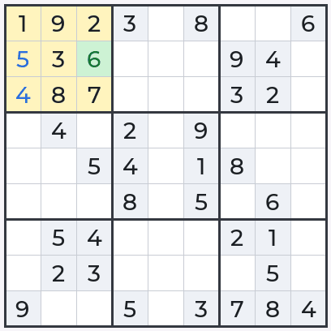

<!-- Written by tools/walkthrough.py dutch-flatmates: edit the script, not this page. -->
# Dutch Flatmates, step 3: the 6 in box 1

**Step 3 of 45** · [← Step 2](step-02.md) · [All steps](../dutch-flatmates.md#the-whole-puzzle-step-by-step) · [Step 4 →](step-04.md)

Box 1 needs a 6, and r2c3 is its last empty cell: **r2c3 = 6**.

**Step 3 of 45** · [← Step 2](step-02.md) · [All steps](../dutch-flatmates.md#the-whole-puzzle-step-by-step) · [Step 4 →](step-04.md)
