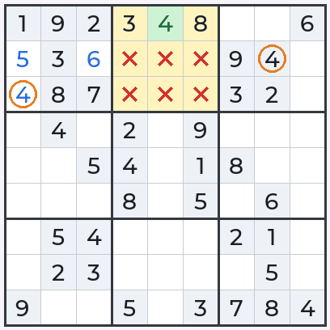

<!-- Written by tools/walkthrough.py dutch-flatmates: edit the script, not this page. -->
# Dutch Flatmates, step 4: the 4 in box 2

**Step 4 of 45** · [← Step 3](step-03.md) · [All steps](../dutch-flatmates.md#the-whole-puzzle-step-by-step) · [Step 5 →](step-05.md)

Box 2 needs a 4. r2c4, r2c5 and r2c6: row 2 has one (r2c8). r3c4, r3c5 and r3c6: row 3 has one (r3c1). Only **r1c5** is left: **r1c5 = 4**.

**Step 4 of 45** · [← Step 3](step-03.md) · [All steps](../dutch-flatmates.md#the-whole-puzzle-step-by-step) · [Step 5 →](step-05.md)
