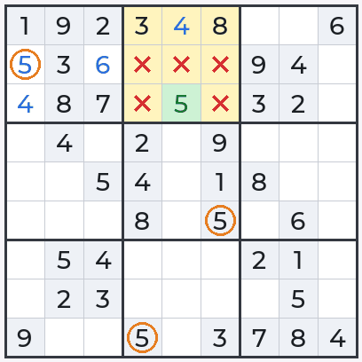

<!-- Written by tools/walkthrough.py dutch-flatmates: edit the script, not this page. -->
# Dutch Flatmates, step 5: the 5 in box 2

**Step 5 of 45** · [← Step 4](step-04.md) · [All steps](../dutch-flatmates.md#the-whole-puzzle-step-by-step) · [Step 6 →](step-06.md)

Box 2 needs a 5. r2c4, r2c5 and r2c6: row 2 has one (r2c1). r3c4: column 4 has one (r9c4). r3c6: column 6 has one (r6c6). Only **r3c5** is left: **r3c5 = 5**.

**Step 5 of 45** · [← Step 4](step-04.md) · [All steps](../dutch-flatmates.md#the-whole-puzzle-step-by-step) · [Step 6 →](step-06.md)
