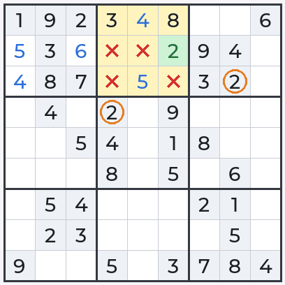

<!-- Written by tools/walkthrough.py dutch-flatmates: edit the script, not this page. -->
# Dutch Flatmates, step 6: the 2 in box 2

**Step 6 of 45** · [← Step 5](step-05.md) · [All steps](../dutch-flatmates.md#the-whole-puzzle-step-by-step) · [Step 7 →](step-07.md)

Box 2 needs a 2. r2c4: column 4 has one (r4c4). r3c4 and r3c6: row 3 has one (r3c8). r2c5: the 5 in r3c5 needs a 1 right above it, as r4c5 below it can't be 9. Only **r2c6** is left: **r2c6 = 2**.

**Step 6 of 45** · [← Step 5](step-05.md) · [All steps](../dutch-flatmates.md#the-whole-puzzle-step-by-step) · [Step 7 →](step-07.md)
