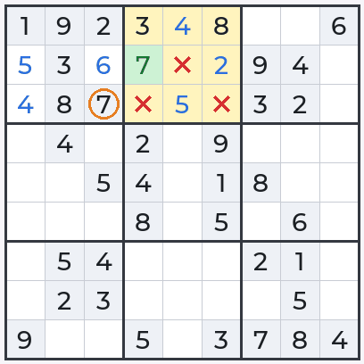

<!-- Written by tools/walkthrough.py dutch-flatmates: edit the script, not this page. -->
# Dutch Flatmates, step 7: the 7 in box 2

**Step 7 of 45** · [← Step 6](step-06.md) · [All steps](../dutch-flatmates.md#the-whole-puzzle-step-by-step) · [Step 8 →](step-08.md)

Box 2 needs a 7. r3c4 and r3c6: row 3 has one (r3c3). r2c5: the 5 in r3c5 needs a 1 right above it, as r4c5 below it can't be 9. Only **r2c4** is left: **r2c4 = 7**.

**Step 7 of 45** · [← Step 6](step-06.md) · [All steps](../dutch-flatmates.md#the-whole-puzzle-step-by-step) · [Step 8 →](step-08.md)
