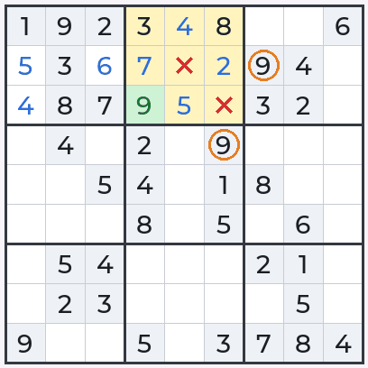

<!-- Written by tools/walkthrough.py dutch-flatmates: edit the script, not this page. -->
# Dutch Flatmates, step 8: the 9 in box 2

**Step 8 of 45** · [← Step 7](step-07.md) · [All steps](../dutch-flatmates.md#the-whole-puzzle-step-by-step) · [Step 9 →](step-09.md)

Box 2 needs a 9. r2c5: row 2 has one (r2c7). r3c6: column 6 has one (r4c6). Only **r3c4** is left: **r3c4 = 9**.

**Step 8 of 45** · [← Step 7](step-07.md) · [All steps](../dutch-flatmates.md#the-whole-puzzle-step-by-step) · [Step 9 →](step-09.md)
