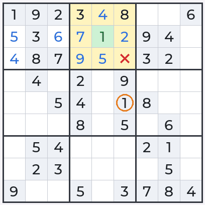

<!-- Written by tools/walkthrough.py dutch-flatmates: edit the script, not this page. -->
# Dutch Flatmates, step 9: the 1 in box 2

**Step 9 of 45** · [← Step 8](step-08.md) · [All steps](../dutch-flatmates.md#the-whole-puzzle-step-by-step) · [Step 10 →](step-10.md)

Box 2 needs a 1. r3c6: column 6 has one (r5c6). Only **r2c5** is left: **r2c5 = 1**.

**Step 9 of 45** · [← Step 8](step-08.md) · [All steps](../dutch-flatmates.md#the-whole-puzzle-step-by-step) · [Step 10 →](step-10.md)
