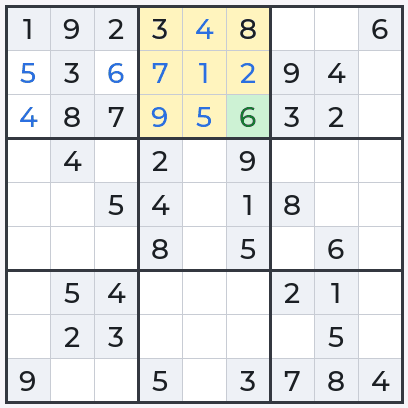

<!-- Written by tools/walkthrough.py dutch-flatmates: edit the script, not this page. -->
# Dutch Flatmates, step 10: the 6 in box 2

**Step 10 of 45** · [← Step 9](step-09.md) · [All steps](../dutch-flatmates.md#the-whole-puzzle-step-by-step) · [Step 11 →](step-11.md)

Box 2 needs a 6, and r3c6 is its last empty cell: **r3c6 = 6**.

**Step 10 of 45** · [← Step 9](step-09.md) · [All steps](../dutch-flatmates.md#the-whole-puzzle-step-by-step) · [Step 11 →](step-11.md)
