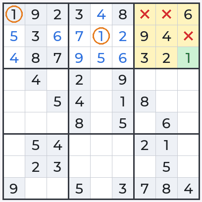

<!-- Written by tools/walkthrough.py dutch-flatmates: edit the script, not this page. -->
# Dutch Flatmates, step 11: the 1 in box 3

**Step 11 of 45** · [← Step 10](step-10.md) · [All steps](../dutch-flatmates.md#the-whole-puzzle-step-by-step) · [Step 12 →](step-12.md)

Box 3 needs a 1. r1c7 and r1c8: row 1 has one (r1c1). r2c9: row 2 has one (r2c5). Only **r3c9** is left: **r3c9 = 1**.

**Step 11 of 45** · [← Step 10](step-10.md) · [All steps](../dutch-flatmates.md#the-whole-puzzle-step-by-step) · [Step 12 →](step-12.md)
