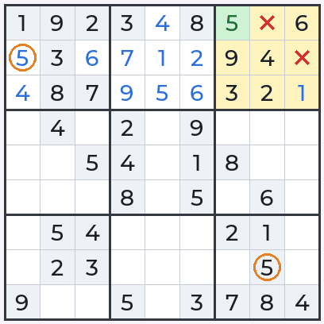

<!-- Written by tools/walkthrough.py dutch-flatmates: edit the script, not this page. -->
# Dutch Flatmates, step 12: the 5 in box 3

**Step 12 of 45** · [← Step 11](step-11.md) · [All steps](../dutch-flatmates.md#the-whole-puzzle-step-by-step) · [Step 13 →](step-13.md)

Box 3 needs a 5. r1c8: column 8 has one (r8c8). r2c9: row 2 has one (r2c1). Only **r1c7** is left: **r1c7 = 5**.

**Step 12 of 45** · [← Step 11](step-11.md) · [All steps](../dutch-flatmates.md#the-whole-puzzle-step-by-step) · [Step 13 →](step-13.md)
