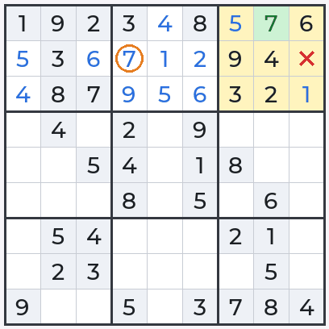

<!-- Written by tools/walkthrough.py dutch-flatmates: edit the script, not this page. -->
# Dutch Flatmates, step 13: the 7 in box 3

**Step 13 of 45** · [← Step 12](step-12.md) · [All steps](../dutch-flatmates.md#the-whole-puzzle-step-by-step) · [Step 14 →](step-14.md)

Box 3 needs a 7. r2c9: row 2 has one (r2c4). Only **r1c8** is left: **r1c8 = 7**.

**Step 13 of 45** · [← Step 12](step-12.md) · [All steps](../dutch-flatmates.md#the-whole-puzzle-step-by-step) · [Step 14 →](step-14.md)
