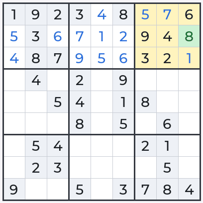

<!-- Written by tools/walkthrough.py dutch-flatmates: edit the script, not this page. -->
# Dutch Flatmates, step 14: the 8 in box 3

**Step 14 of 45** · [← Step 13](step-13.md) · [All steps](../dutch-flatmates.md#the-whole-puzzle-step-by-step) · [Step 15 →](step-15.md)

Box 3 needs an 8, and r2c9 is its last empty cell: **r2c9 = 8**.

**Step 14 of 45** · [← Step 13](step-13.md) · [All steps](../dutch-flatmates.md#the-whole-puzzle-step-by-step) · [Step 15 →](step-15.md)
