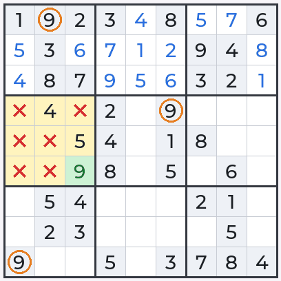

<!-- Written by tools/walkthrough.py dutch-flatmates: edit the script, not this page. -->
# Dutch Flatmates, step 15: the 9 in box 4

**Step 15 of 45** · [← Step 14](step-14.md) · [All steps](../dutch-flatmates.md#the-whole-puzzle-step-by-step) · [Step 16 →](step-16.md)

Box 4 needs a 9. r4c1 and r4c3: row 4 has one (r4c6). r5c1 and r6c1: column 1 has one (r9c1). r5c2 and r6c2: column 2 has one (r1c2). Only **r6c3** is left: **r6c3 = 9**.

**Step 15 of 45** · [← Step 14](step-14.md) · [All steps](../dutch-flatmates.md#the-whole-puzzle-step-by-step) · [Step 16 →](step-16.md)
