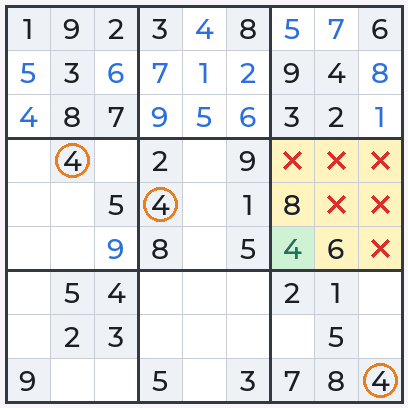

<!-- Written by tools/walkthrough.py dutch-flatmates: edit the script, not this page. -->
# Dutch Flatmates, step 16: the 4 in box 6

**Step 16 of 45** · [← Step 15](step-15.md) · [All steps](../dutch-flatmates.md#the-whole-puzzle-step-by-step) · [Step 17 →](step-17.md)

Box 6 needs a 4. r4c7, r4c8 and r4c9: row 4 has one (r4c2). r5c8 and r5c9: row 5 has one (r5c4). r6c9: column 9 has one (r9c9). Only **r6c7** is left: **r6c7 = 4**.

**Step 16 of 45** · [← Step 15](step-15.md) · [All steps](../dutch-flatmates.md#the-whole-puzzle-step-by-step) · [Step 17 →](step-17.md)
