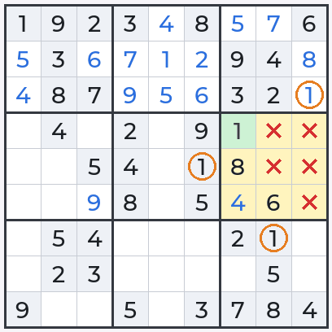

<!-- Written by tools/walkthrough.py dutch-flatmates: edit the script, not this page. -->
# Dutch Flatmates, step 17: the 1 in box 6

**Step 17 of 45** · [← Step 16](step-16.md) · [All steps](../dutch-flatmates.md#the-whole-puzzle-step-by-step) · [Step 18 →](step-18.md)

Box 6 needs a 1. r4c8: column 8 has one (r7c8). r4c9 and r6c9: column 9 has one (r3c9). r5c8 and r5c9: row 5 has one (r5c6). Only **r4c7** is left: **r4c7 = 1**.

**Step 17 of 45** · [← Step 16](step-16.md) · [All steps](../dutch-flatmates.md#the-whole-puzzle-step-by-step) · [Step 18 →](step-18.md)
