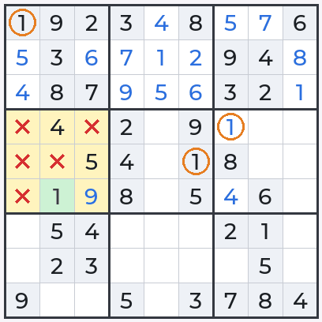

<!-- Written by tools/walkthrough.py dutch-flatmates: edit the script, not this page. -->
# Dutch Flatmates, step 18: the 1 in box 4

**Step 18 of 45** · [← Step 17](step-17.md) · [All steps](../dutch-flatmates.md#the-whole-puzzle-step-by-step) · [Step 19 →](step-19.md)

Box 4 needs a 1. r4c1 and r4c3: row 4 has one (r4c7). r5c1 and r5c2: row 5 has one (r5c6). r6c1: column 1 has one (r1c1). Only **r6c2** is left: **r6c2 = 1**.

**Step 18 of 45** · [← Step 17](step-17.md) · [All steps](../dutch-flatmates.md#the-whole-puzzle-step-by-step) · [Step 19 →](step-19.md)
