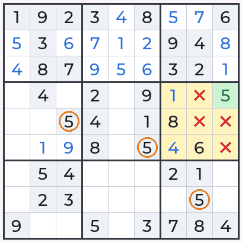

<!-- Written by tools/walkthrough.py dutch-flatmates: edit the script, not this page. -->
# Dutch Flatmates, step 19: the 5 in box 6

**Step 19 of 45** · [← Step 18](step-18.md) · [All steps](../dutch-flatmates.md#the-whole-puzzle-step-by-step) · [Step 20 →](step-20.md)

Box 6 needs a 5. r4c8: column 8 has one (r8c8). r5c8 and r5c9: row 5 has one (r5c3). r6c9: row 6 has one (r6c6). Only **r4c9** is left: **r4c9 = 5**.

**Step 19 of 45** · [← Step 18](step-18.md) · [All steps](../dutch-flatmates.md#the-whole-puzzle-step-by-step) · [Step 20 →](step-20.md)
