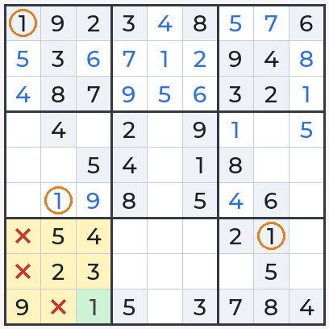

<!-- Written by tools/walkthrough.py dutch-flatmates: edit the script, not this page. -->
# Dutch Flatmates, step 20: the 1 in box 7

**Step 20 of 45** · [← Step 19](step-19.md) · [All steps](../dutch-flatmates.md#the-whole-puzzle-step-by-step) · [Step 21 →](step-21.md)

Box 7 needs a 1. r7c1: row 7 has one (r7c8). r8c1: column 1 has one (r1c1). r9c2: column 2 has one (r6c2). Only **r9c3** is left: **r9c3 = 1**.

**Step 20 of 45** · [← Step 19](step-19.md) · [All steps](../dutch-flatmates.md#the-whole-puzzle-step-by-step) · [Step 21 →](step-21.md)
