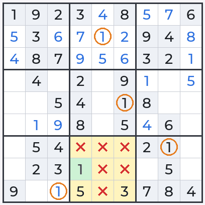

<!-- Written by tools/walkthrough.py dutch-flatmates: edit the script, not this page. -->
# Dutch Flatmates, step 21: the 1 in box 8

**Step 21 of 45** · [← Step 20](step-20.md) · [All steps](../dutch-flatmates.md#the-whole-puzzle-step-by-step) · [Step 22 →](step-22.md)

Box 8 needs a 1. r7c4, r7c5 and r7c6: row 7 has one (r7c8). r8c5: column 5 has one (r2c5). r8c6: column 6 has one (r5c6). r9c5: row 9 has one (r9c3). Only **r8c4** is left: **r8c4 = 1**.

**Step 21 of 45** · [← Step 20](step-20.md) · [All steps](../dutch-flatmates.md#the-whole-puzzle-step-by-step) · [Step 22 →](step-22.md)
