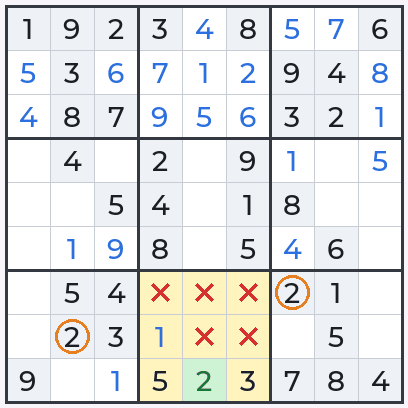

<!-- Written by tools/walkthrough.py dutch-flatmates: edit the script, not this page. -->
# Dutch Flatmates, step 22: the 2 in box 8

**Step 22 of 45** · [← Step 21](step-21.md) · [All steps](../dutch-flatmates.md#the-whole-puzzle-step-by-step) · [Step 23 →](step-23.md)

Box 8 needs a 2. r7c4, r7c5 and r7c6: row 7 has one (r7c7). r8c5 and r8c6: row 8 has one (r8c2). Only **r9c5** is left: **r9c5 = 2**.

**Step 22 of 45** · [← Step 21](step-21.md) · [All steps](../dutch-flatmates.md#the-whole-puzzle-step-by-step) · [Step 23 →](step-23.md)
