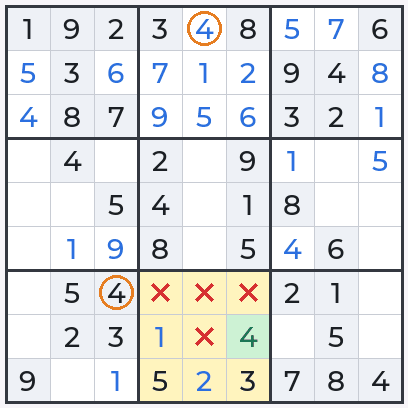

<!-- Written by tools/walkthrough.py dutch-flatmates: edit the script, not this page. -->
# Dutch Flatmates, step 23: the 4 in box 8

**Step 23 of 45** · [← Step 22](step-22.md) · [All steps](../dutch-flatmates.md#the-whole-puzzle-step-by-step) · [Step 24 →](step-24.md)

Box 8 needs a 4. r7c4, r7c5 and r7c6: row 7 has one (r7c3). r8c5: column 5 has one (r1c5). Only **r8c6** is left: **r8c6 = 4**.

**Step 23 of 45** · [← Step 22](step-22.md) · [All steps](../dutch-flatmates.md#the-whole-puzzle-step-by-step) · [Step 24 →](step-24.md)
