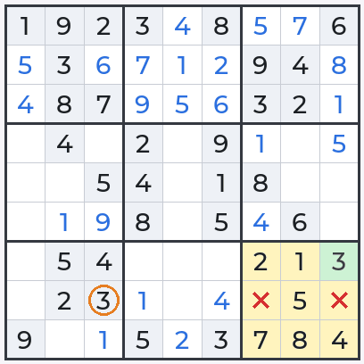

<!-- Written by tools/walkthrough.py dutch-flatmates: edit the script, not this page. -->
# Dutch Flatmates, step 24: the 3 in box 9

**Step 24 of 45** · [← Step 23](step-23.md) · [All steps](../dutch-flatmates.md#the-whole-puzzle-step-by-step) · [Step 25 →](step-25.md)

Box 9 needs a 3. r8c7 and r8c9: row 8 has one (r8c3). Only **r7c9** is left: **r7c9 = 3**.

**Step 24 of 45** · [← Step 23](step-23.md) · [All steps](../dutch-flatmates.md#the-whole-puzzle-step-by-step) · [Step 25 →](step-25.md)
