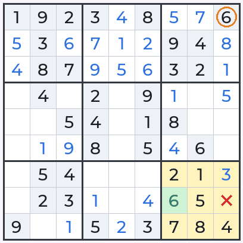

<!-- Written by tools/walkthrough.py dutch-flatmates: edit the script, not this page. -->
# Dutch Flatmates, step 25: the 6 in box 9

**Step 25 of 45** · [← Step 24](step-24.md) · [All steps](../dutch-flatmates.md#the-whole-puzzle-step-by-step) · [Step 26 →](step-26.md)

Box 9 needs a 6. r8c9: column 9 has one (r1c9). Only **r8c7** is left: **r8c7 = 6**.

**Step 25 of 45** · [← Step 24](step-24.md) · [All steps](../dutch-flatmates.md#the-whole-puzzle-step-by-step) · [Step 26 →](step-26.md)
