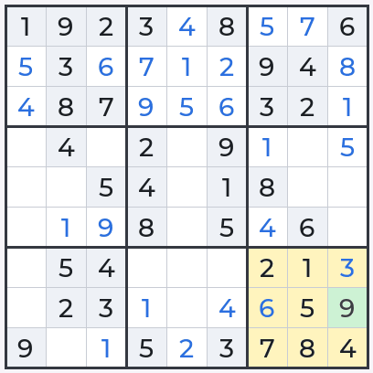

<!-- Written by tools/walkthrough.py dutch-flatmates: edit the script, not this page. -->
# Dutch Flatmates, step 26: the 9 in box 9

**Step 26 of 45** · [← Step 25](step-25.md) · [All steps](../dutch-flatmates.md#the-whole-puzzle-step-by-step) · [Step 27 →](step-27.md)

Box 9 needs a 9, and r8c9 is its last empty cell: **r8c9 = 9**.

**Step 26 of 45** · [← Step 25](step-25.md) · [All steps](../dutch-flatmates.md#the-whole-puzzle-step-by-step) · [Step 27 →](step-27.md)
