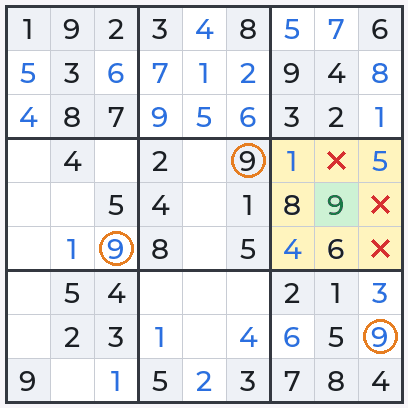

<!-- Written by tools/walkthrough.py dutch-flatmates: edit the script, not this page. -->
# Dutch Flatmates, step 27: the 9 in box 6

**Step 27 of 45** · [← Step 26](step-26.md) · [All steps](../dutch-flatmates.md#the-whole-puzzle-step-by-step) · [Step 28 →](step-28.md)

Box 6 needs a 9. r4c8: row 4 has one (r4c6). r5c9: column 9 has one (r8c9). r6c9: row 6 has one (r6c3). Only **r5c8** is left: **r5c8 = 9**.

**Step 27 of 45** · [← Step 26](step-26.md) · [All steps](../dutch-flatmates.md#the-whole-puzzle-step-by-step) · [Step 28 →](step-28.md)
