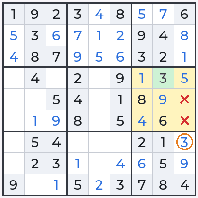

<!-- Written by tools/walkthrough.py dutch-flatmates: edit the script, not this page. -->
# Dutch Flatmates, step 28: the 3 in box 6

**Step 28 of 45** · [← Step 27](step-27.md) · [All steps](../dutch-flatmates.md#the-whole-puzzle-step-by-step) · [Step 29 →](step-29.md)

Box 6 needs a 3. r5c9 and r6c9: column 9 has one (r7c9). Only **r4c8** is left: **r4c8 = 3**.

**Step 28 of 45** · [← Step 27](step-27.md) · [All steps](../dutch-flatmates.md#the-whole-puzzle-step-by-step) · [Step 29 →](step-29.md)
