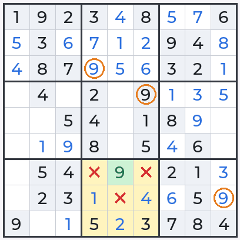

<!-- Written by tools/walkthrough.py dutch-flatmates: edit the script, not this page. -->
# Dutch Flatmates, step 29: the 9 in box 8

**Step 29 of 45** · [← Step 28](step-28.md) · [All steps](../dutch-flatmates.md#the-whole-puzzle-step-by-step) · [Step 30 →](step-30.md)

Box 8 needs a 9. r7c4: column 4 has one (r3c4). r7c6: column 6 has one (r4c6). r8c5: row 8 has one (r8c9). Only **r7c5** is left: **r7c5 = 9**.

**Step 29 of 45** · [← Step 28](step-28.md) · [All steps](../dutch-flatmates.md#the-whole-puzzle-step-by-step) · [Step 30 →](step-30.md)
