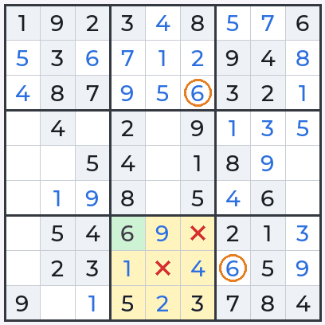

<!-- Written by tools/walkthrough.py dutch-flatmates: edit the script, not this page. -->
# Dutch Flatmates, step 30: the 6 in box 8

**Step 30 of 45** · [← Step 29](step-29.md) · [All steps](../dutch-flatmates.md#the-whole-puzzle-step-by-step) · [Step 31 →](step-31.md)

Box 8 needs a 6. r7c6: column 6 has one (r3c6). r8c5: row 8 has one (r8c7). Only **r7c4** is left: **r7c4 = 6**.

**Step 30 of 45** · [← Step 29](step-29.md) · [All steps](../dutch-flatmates.md#the-whole-puzzle-step-by-step) · [Step 31 →](step-31.md)
