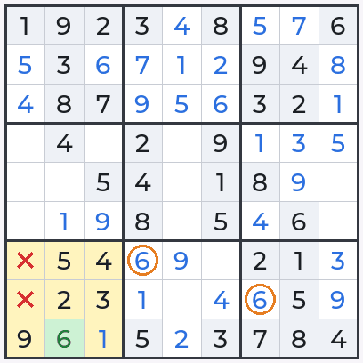

<!-- Written by tools/walkthrough.py dutch-flatmates: edit the script, not this page. -->
# Dutch Flatmates, step 31: the 6 in box 7

**Step 31 of 45** · [← Step 30](step-30.md) · [All steps](../dutch-flatmates.md#the-whole-puzzle-step-by-step) · [Step 32 →](step-32.md)

Box 7 needs a 6. r7c1: row 7 has one (r7c4). r8c1: row 8 has one (r8c7). Only **r9c2** is left: **r9c2 = 6**.

**Step 31 of 45** · [← Step 30](step-30.md) · [All steps](../dutch-flatmates.md#the-whole-puzzle-step-by-step) · [Step 32 →](step-32.md)
