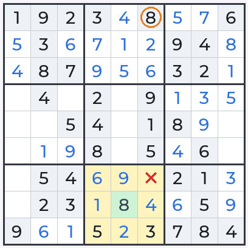

<!-- Written by tools/walkthrough.py dutch-flatmates: edit the script, not this page. -->
# Dutch Flatmates, step 32: the 8 in box 8

**Step 32 of 45** · [← Step 31](step-31.md) · [All steps](../dutch-flatmates.md#the-whole-puzzle-step-by-step) · [Step 33 →](step-33.md)

Box 8 needs an 8. r7c6: column 6 has one (r1c6). Only **r8c5** is left: **r8c5 = 8**.

**Step 32 of 45** · [← Step 31](step-31.md) · [All steps](../dutch-flatmates.md#the-whole-puzzle-step-by-step) · [Step 33 →](step-33.md)
