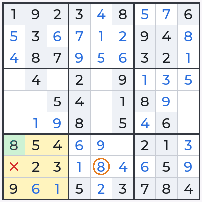

<!-- Written by tools/walkthrough.py dutch-flatmates: edit the script, not this page. -->
# Dutch Flatmates, step 33: the 8 in box 7

**Step 33 of 45** · [← Step 32](step-32.md) · [All steps](../dutch-flatmates.md#the-whole-puzzle-step-by-step) · [Step 34 →](step-34.md)

Box 7 needs an 8. r8c1: row 8 has one (r8c5). Only **r7c1** is left: **r7c1 = 8**.

**Step 33 of 45** · [← Step 32](step-32.md) · [All steps](../dutch-flatmates.md#the-whole-puzzle-step-by-step) · [Step 34 →](step-34.md)
