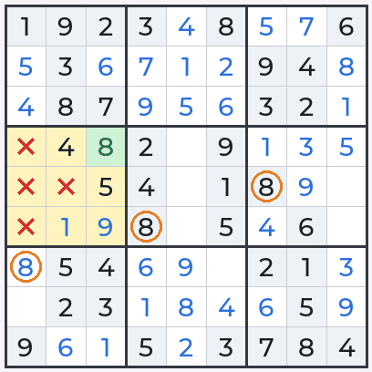

<!-- Written by tools/walkthrough.py dutch-flatmates: edit the script, not this page. -->
# Dutch Flatmates, step 34: the 8 in box 4

**Step 34 of 45** · [← Step 33](step-33.md) · [All steps](../dutch-flatmates.md#the-whole-puzzle-step-by-step) · [Step 35 →](step-35.md)

Box 4 needs an 8. r4c1: column 1 has one (r7c1). r5c1 and r5c2: row 5 has one (r5c7). r6c1: row 6 has one (r6c4). Only **r4c3** is left: **r4c3 = 8**.

**Step 34 of 45** · [← Step 33](step-33.md) · [All steps](../dutch-flatmates.md#the-whole-puzzle-step-by-step) · [Step 35 →](step-35.md)
