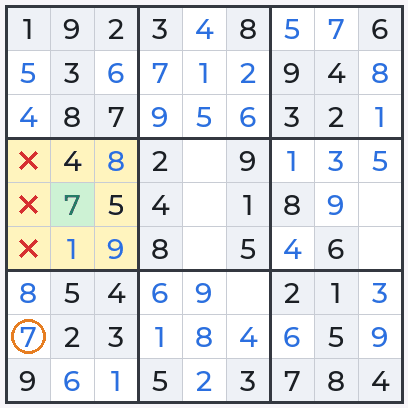

<!-- Written by tools/walkthrough.py dutch-flatmates: edit the script, not this page. -->
# Dutch Flatmates, step 36: the 7 in box 4

**Step 36 of 45** · [← Step 35](step-35.md) · [All steps](../dutch-flatmates.md#the-whole-puzzle-step-by-step) · [Step 37 →](step-37.md)

Box 4 needs a 7. r4c1, r5c1 and r6c1: column 1 has one (r8c1). Only **r5c2** is left: **r5c2 = 7**.

**Step 36 of 45** · [← Step 35](step-35.md) · [All steps](../dutch-flatmates.md#the-whole-puzzle-step-by-step) · [Step 37 →](step-37.md)
