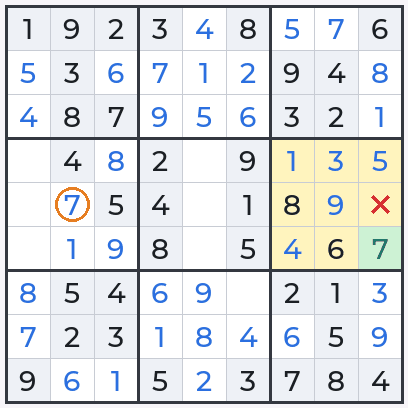

<!-- Written by tools/walkthrough.py dutch-flatmates: edit the script, not this page. -->
# Dutch Flatmates, step 37: the 7 in box 6

**Step 37 of 45** · [← Step 36](step-36.md) · [All steps](../dutch-flatmates.md#the-whole-puzzle-step-by-step) · [Step 38 →](step-38.md)

Box 6 needs a 7. r5c9: row 5 has one (r5c2). Only **r6c9** is left: **r6c9 = 7**.

**Step 37 of 45** · [← Step 36](step-36.md) · [All steps](../dutch-flatmates.md#the-whole-puzzle-step-by-step) · [Step 38 →](step-38.md)
