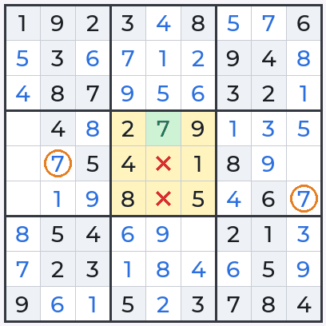

<!-- Written by tools/walkthrough.py dutch-flatmates: edit the script, not this page. -->
# Dutch Flatmates, step 38: the 7 in box 5

**Step 38 of 45** · [← Step 37](step-37.md) · [All steps](../dutch-flatmates.md#the-whole-puzzle-step-by-step) · [Step 39 →](step-39.md)

Box 5 needs a 7. r5c5: row 5 has one (r5c2). r6c5: row 6 has one (r6c9). Only **r4c5** is left: **r4c5 = 7**.

**Step 38 of 45** · [← Step 37](step-37.md) · [All steps](../dutch-flatmates.md#the-whole-puzzle-step-by-step) · [Step 39 →](step-39.md)
