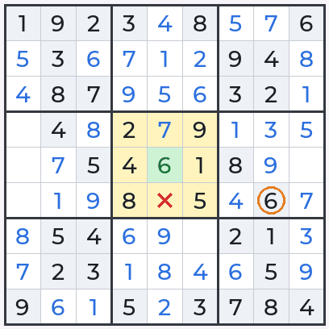

<!-- Written by tools/walkthrough.py dutch-flatmates: edit the script, not this page. -->
# Dutch Flatmates, step 39: the 6 in box 5

**Step 39 of 45** · [← Step 38](step-38.md) · [All steps](../dutch-flatmates.md#the-whole-puzzle-step-by-step) · [Step 40 →](step-40.md)

Box 5 needs a 6. r6c5: row 6 has one (r6c8). Only **r5c5** is left: **r5c5 = 6**.

**Step 39 of 45** · [← Step 38](step-38.md) · [All steps](../dutch-flatmates.md#the-whole-puzzle-step-by-step) · [Step 40 →](step-40.md)
